# Mod cover artwork

These illustrations were made with the built-in imagegen tool. The final generation prompts are recorded below. The original generated PNGs were exported as 640 × 360, quality-90 JPEG thumbnails with ImageMagick; no content retouching was applied.

Source thumbnails live in `mods/<Name>/cover.jpg`. Publishing copies them to `dist/<Name>.cover.jpg` and records the filename in `dist/manifest.json`. Covers are separate from the DLL/PDB install files. In game, open F7 and press **Refresh** to fetch them.

## BuildShapes

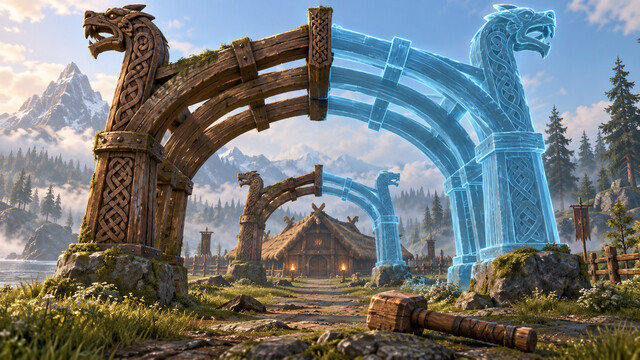

Final prompt:

Create a beautiful premium cover illustration for a Valheim game mod. WIDE LANDSCAPE 16:9 composition, intended as a 640 by 360 thumbnail displayed as small as 128 by 72. Art direction: tactile stylized Nordic fantasy, chunky low-poly forms with painterly hand-painted surfaces, weathered wood, moss and bronze, restrained earthy palette, cinematic natural light, atmospheric depth. Polished game key art, strong readable silhouette, one dominant subject centered with generous safe margins. Make the subject recognizable at tiny size. No lettering, words, logos, UI, border, watermark, neon colors or shiny plastic. Render a single complete illustration filling the frame. An impressive ornate Viking timber arch takes up most of the frame, richly carved dragon-head beam tips, warm weathered wood and a few curved ribs leading toward a small thatched longhouse. The left half of the arch is solid physical wood; its matching right half continues as a delicate translucent cyan-blue construction ghost with clearly visible individual timber beams forming the curve. A second smaller paired arch recedes behind it to suggest repeated and mirrored building pieces. A wooden builder's hammer lies in the foreground. A misty meadow and pines stay simple in the background. Beautiful practical architectural planning: satisfying curves, symmetry and craftsmanship. Cyan is used only sparingly for the ghost beams, no sci-fi screens or grids.

## ChestSearch

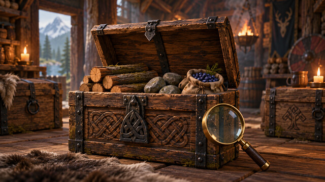

Final prompt:

Create a beautiful premium cover illustration for a Valheim game mod. WIDE LANDSCAPE 16:9 composition, intended as a 640 by 360 thumbnail displayed as small as 128 by 72. Art direction: tactile stylized Nordic fantasy, chunky low-poly forms with painterly hand-painted surfaces, weathered wood, moss and bronze, restrained earthy palette, cinematic natural light, atmospheric depth. Polished game key art, strong readable silhouette, one dominant subject centered with generous safe margins. Make the subject recognizable at tiny size. No lettering, words, logos, UI, border, watermark, neon colors or shiny plastic. Render a single complete illustration filling the frame. A large beautifully made Viking storage chest is the dominant foreground object: weathered oak planks, dark forged iron straps, carved knotwork, lid propped open. Inside are a neatly arranged small bundle of timber, rounded stones and a cloth pouch of blue berries, softly lit by warm amber light. A large simple brass magnifying glass with a clear circular glass lens leans against the front corner of the chest as a visual symbol of searching. Two smaller timber chests sit softly out of focus behind it in a cozy Viking storeroom, candlelight and a hint of smoky rafters. Treasure is everyday useful forest supplies, no overflowing gold coins. The chest and circular magnifying glass silhouette must be readable at tiny size.

## Farmhand

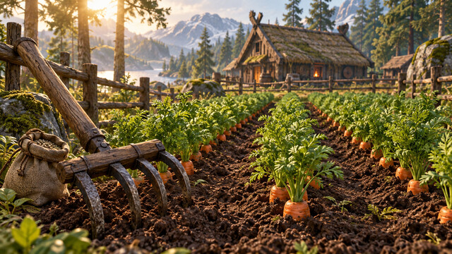

Final prompt:

Create a beautiful premium cover illustration for a Valheim game mod. WIDE LANDSCAPE 16:9 composition, intended as a 640 by 360 thumbnail displayed as small as 128 by 72. Art direction: tactile stylized Nordic fantasy, chunky low-poly forms with painterly hand-painted surfaces, weathered wood, moss and bronze, restrained earthy palette, cinematic natural light, atmospheric depth. Polished game key art, strong readable silhouette, one dominant subject centered with generous safe margins. Make the subject recognizable at tiny size. No lettering, words, logos, UI, border, watermark, neon colors or shiny plastic. Render a single complete illustration filling the frame. A cheerful productive Viking vegetable garden in a sunlit forest clearing, with three bold neat parallel rows of lush carrot greens and visible orange carrot shoulders in freshly tilled dark soil. A sturdy primitive wooden cultivator with curved forged iron tines and a small burlap seed pouch occupy the close foreground, diagonal tools framing the rows. A low split-rail fence and rustic thatched longhouse in the distance, warm golden morning sun, lush restrained green and rich earthy brown palette. Close view with large readable plants and cultivation tool, satisfying orderly crop rows sweeping into the distance. No people necessary, no machinery, no lettering.

## Gary

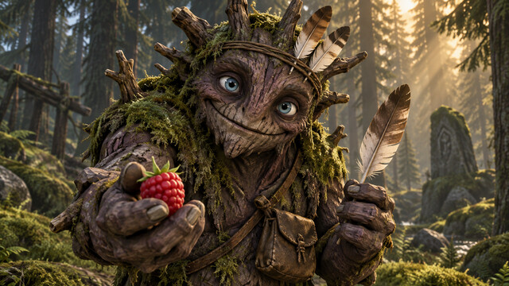

Final prompt:

Create a beautiful premium cover illustration for a Valheim game mod. WIDE LANDSCAPE 16:9 composition, intended as a 640 by 360 thumbnail displayed as small as 128 by 72. Art direction: tactile stylized Nordic fantasy, chunky low-poly forms with painterly hand-painted surfaces, weathered wood, moss and bronze, restrained earthy palette, cinematic natural light, atmospheric depth. Polished game key art, strong readable silhouette, one dominant subject centered with generous safe margins. Make the subject recognizable at tiny size. No lettering, words, logos, UI, border, watermark, neon colors or shiny plastic. Render a single complete illustration filling the frame. A lovable friendly greydwarf forest companion: squat sturdy humanoid made of gnarly bark and branches, muted plum-purple bark skin, large expressive pale blue eyes, a small simple twig band with three natural matte brown and cream feathers, moss on shoulders, little worn leather pouch. Gary smiles gently and offers a red raspberry in one hand, with a feather in the other. Half-body close portrait filling most of the frame, dark pine forest behind him with warm golden shafts of sunlight and soft green moss. Charming and slightly mischievous, convincingly a Valheim greydwarf rather than a human, goblin, or toy. Accessories are matte and naturally colored, never glowing.

## PolygonLeveler

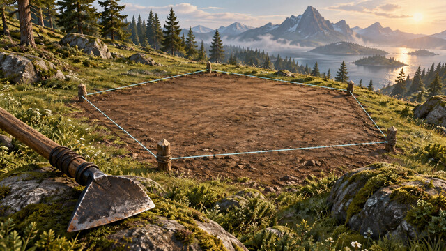

Final prompt:

Create a beautiful premium cover illustration for a Valheim game mod. WIDE LANDSCAPE 16:9 composition, intended as a 640 by 360 thumbnail displayed as small as 128 by 72. Art direction: tactile stylized Nordic fantasy, chunky low-poly forms with painterly hand-painted surfaces, weathered wood, moss and bronze, restrained earthy palette, cinematic natural light, atmospheric depth. Polished game key art, strong readable silhouette, one dominant subject centered with generous safe margins. Make the subject recognizable at tiny size. No lettering, words, logos, UI, border, watermark, neon colors or shiny plastic. Render a single complete illustration filling the frame. A clearly flattened pentagonal building pad cut into an otherwise rolling grassy Nordic hillside. Low oblique view makes the smooth level earth surface and the uneven surrounding terrain unmistakable. Five simple wooden survey stakes bound the pad, linked by thin restrained pale cyan lines along the pentagon edges, showing the player's chosen polygon. A primitive wooden hoe with a forged metal blade dominates one lower foreground corner. Around the pad are gentle grassy slopes, rocks and pine trees in warm afternoon light. The pad is a clean natural earthy clearing ready for a Viking building, no building yet. Strong simple terrain geometry, tactile soil and moss, not blocky Minecraft cubes, no technical labels or diagrams.

## Spyglass

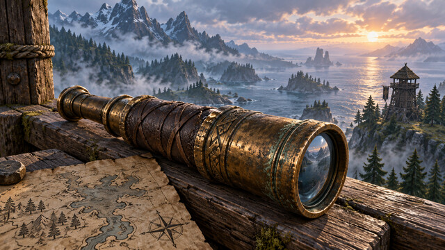

Final prompt:

Create a beautiful premium cover illustration for a Valheim game mod. WIDE LANDSCAPE 16:9 composition, intended as a 640 by 360 thumbnail displayed as small as 128 by 72. Art direction: tactile stylized Nordic fantasy, chunky low-poly forms with painterly hand-painted surfaces, weathered wood, moss and bronze, restrained earthy palette, cinematic natural light, atmospheric depth. Polished game key art, strong readable silhouette, one dominant subject centered with generous safe margins. Make the subject recognizable at tiny size. No lettering, words, logos, UI, border, watermark, neon colors or shiny plastic. Render a single complete illustration filling the frame. A primitive Viking bronze spyglass dominates the foreground, lying diagonally on a weathered timber lookout railing: elegant short tapered bronze telescope with patinated metal rings and a dark leather-wrapped grip. Beyond it a sweeping misty Nordic fjord, blue-gray sea, rocky islands, dark pines and a small distant timber watchtower. A corner of a hand-drawn parchment coastline map lies under the telescope. Dramatic cool dawn atmosphere contrasted with warm bronze highlights. The telescope is large and immediately recognizable; the scenery stays simple and secondary.

## BobsPipes

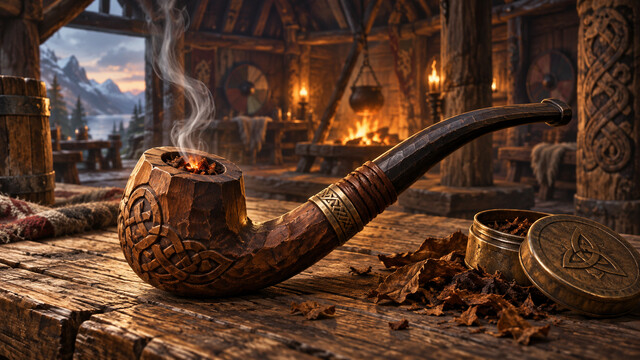

Generated with the built-in imagegen tool, exported with ImageMagick to `mods/BobsPipes/cover.jpg` (640 × 360 JPEG).

Final prompt:

Use case: stylized-concept. Asset type: cover for Bob's Pipes, a Valheim mod. Create a beautiful premium game key-art illustration in wide landscape 16:9, intended as a 640x360 thumbnail shown as small as 128x72. Tactile Nordic fantasy, chunky low-poly forms with painterly hand-painted surfaces, weathered wood and bronze, restrained earthy palette, atmospheric warm hearth light. One dominant foreground subject with generous safe margins: a gorgeous hand-carved bent wooden tobacco pipe resting diagonally on a rough oak table, a deep hollow round wooden bowl with subtle carved Norse knotwork, dark curved stem and small leather wrap, tiny warm ember inside and one delicate curl of pale smoke. A small round bronze tobacco tin and a few dry brown tobacco leaves beside it. A cozy Viking longhouse hearth softly blurred in the background, cool dark timber rafters and warm amber fire. Quiet craftsmanship and an immersive evening ritual. Strong readable pipe silhouette. No people, lettering, words, logos, UI, border, watermark, neon colors, giant flames, modern cigarette packaging or shiny plastic. Single complete illustration filling frame.

## DualWield

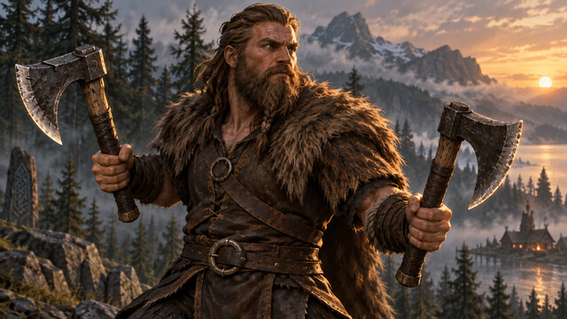

Final prompt:

Use case: stylized-concept. Asset type: DualWield mod-manager cover for Valheim. Create premium Nordic fantasy game key art, WIDE LANDSCAPE 16:9 composition, intended as a 640x360 thumbnail displayed as small as 128x72. Tactile chunky low-poly forms with painterly hand-painted surfaces, weathered wood, dark iron, leather and fur, restrained earthy palette, cinematic natural light, atmospheric depth. A sturdy bearded Viking warrior, waist-up three-quarter view, holds TWO DISTINCT ONE-HANDED AXES, exactly one axe in each hand. Both axes are large and unmistakably visible in the central frame: short weathered wooden handles with simple broad dark forged-iron heads, one held outward on either side of his body in a confident ready stance. His two hands are visible and grip separate axe handles. Simple leather tunic and brown fur mantle, no helmet needed. Warm late-afternoon rim light on the axe edges and warrior against a softly misty dark Nordic pine forest. Strong readable two-axe silhouette; warrior and axes dominate, all axe heads and hands inside generous safe margins, uncluttered background. Authentic grounded Viking equipment, no giant fantasy weapons. No lettering, words, logos, UI, borders, watermark, neon, shiny plastic, swords, shields, extra arms or extra weapons. Render one complete illustration filling the frame.

## Omens

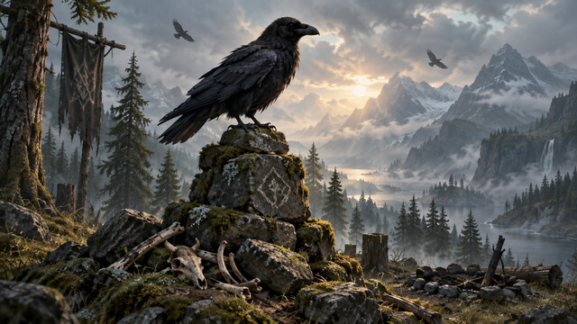

Final prompt:

Use case: stylized-concept. Asset type: Omens mod-manager cover for Valheim. Create beautiful premium Nordic fantasy game key art in WIDE LANDSCAPE 16:9, intended as a 640x360 thumbnail displayed as small as 128x72. Tactile stylized low-poly forms with painterly hand-painted surfaces, weathered stone, moss and dark feathers, restrained earthy palette, cinematic natural light, atmospheric depth. An imposing black raven perched on a squat ancient moss-covered stone cairn dominates the central foreground. Raven shown in clear side silhouette with folded wings, strong curved beak, subtle natural feather highlights, watchful posture. Several stones around the foot of the cairn have fallen aside, revealing a few old pale bones as a quiet warning, no gore. Two small ravens circle overhead in distant mist. Simple Nordic pine forest behind it, a cold abandoned campfire subtly visible beside the stones. Cool muted blue-green dawn mist and a narrow shaft of soft pale amber light separate the raven silhouette from the background. Mysterious, atmospheric, grounded in folklore: signs that the wilderness has something to tell you. One strong focal subject, raven and cairn occupy most of the frame with safe margins, unmistakable readable bird silhouette at tiny size. No lettering, words, logos, UI, borders, watermark, neon, glowing eyes, magical particle effects, shiny plastic, horror gore or busy composition. Render one complete illustration filling the frame.

## Shieldwall

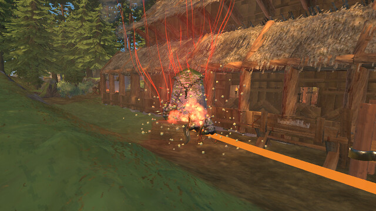

Replaced the live screenshot on 10 October 2026 using the built-in imagegen tool. Final generated edit exported as a 640 × 360 quality-90 JPEG with ImageMagick; source and published copies are identical.

Initial prompt:

Use case: stylized-concept. Asset type: polished 16:9 landscape cover image for Shieldwall, a Valheim Viking tower-defense mod, matching a cohesive set of richly detailed painterly Nordic game-mod covers. Create ONE wide cinematic illustration, no title, text, logo, UI or watermark. Scene: a rugged Viking timber settlement at the edge of a deep pine forest, distant Scandinavian mountains, golden late-afternoon light against cool blue forest shadows. Main focal subject: a large weathered standing Warstone in the near foreground, grey stone with carved Nordic knotwork and restrained glowing runes, grounded in grass and moss. Around and behind it, two handsome timber-and-stone defensive towers with heavy beams and carved dragon eaves; an oversized magical war stave is mounted in a stone socket atop each tower, one firing a warm amber fireball and the other a cool icy-blue projectile toward an approaching forest horde. Readable silhouettes of greydwarf creatures and one distant troll beyond a wooden palisade establish the tower-defense story without clutter or gore. A small Viking defender with a round wooden shield provides scale beside the Warstone. Viking materials: hand-hewn oak, rough stone, carved interlace, wrought iron, thatched roofs, muted red wool banners. Style: premium painted fantasy game key art, tactile crafted materials, gently faceted Valheim-inspired forms, vivid natural colors, crisp focal details, atmospheric background. Clear strong composition that remains legible as a small 640x360 thumbnail, with the Warstone and tower staves prominent; artwork fills the whole frame. Magic is localized and restrained, never neon magenta. Avoid a modern castle, firearms, polished sci-fi surfaces, giant decorative text, cropped main objects, photo realism and generic flat icons.

Final edit prompt, using the initial generated image:

Precise-object-edit of this Shieldwall cover: change ONLY the two weapons mounted on top of the towers. They currently look like short-barreled cannons. Replace each with a clearly recognizable large magical war STAFF: a slender, long carved wooden shaft held in a stone socket on the tower roof, inclined toward the attackers, with an ornate antler-like or wrought-iron pronged head surrounding a glowing amber orb on the left tower and an icy-blue crystal on the middle tower. They should visibly read as Viking sorcerer staves, not firearms, cannons, artillery, or technological turrets. Retain the existing fire and frost projectile trails, originating from the staff heads. Preserve the entire rest of the illustration: the central carved Warstone, Viking defender, round shield, two carved timber towers, red banners, forest horde and troll, palisade, sunset, fjord, mountains, painterly style, material detail, colors, wide 16:9 composition and camera position. No text or logo. This is a cohesive Valheim mod-manager cover image.

## TrophyHall

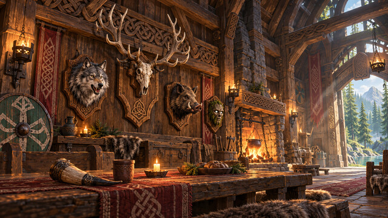

Added the missing cover on 10 October 2026 using the built-in imagegen tool. Exported as a 640 × 360 quality-90 JPEG with ImageMagick; source and published copies are identical.

Final prompt:

Use case: stylized-concept. Asset type: one 16:9 landscape mod-manager cover for TrophyHall, matching richly illustrated Viking / Valheim-inspired game-mod covers. Create a premium painterly fantasy-game illustration of a beautiful, cozy Nordic longhouse trophy hall. No text, titles, logos, UI or watermark. The main subject is a richly carved oak trophy wall beneath massive interlaced timber beams: a magnificent stag skull and antlers on a wooden mounting plaque, a grey wolf head trophy, a wild boar head trophy, and a smaller mossy greydwarf mask displayed on distinct wooden item stands. Tasteful hunting trophies, no blood, gore or grotesque horror. They must be prominent, recognizable and readable at a small 640x360 thumbnail. A long wooden feasting table in the lower foreground holds a drinking horn, simple clay cup and a small candle; a welcoming hearth glows beside the wall. Decorate sparingly with a round painted wooden shield, muted red woven cloth, wrought-iron sconces and Nordic knotwork. Soft golden light from the hearth and sunbeams from a high open doorway illuminate carved wood, smoke motes and stonework; a glimpse of cool green pine forest beyond the doorway gives color contrast. Style: polished painted game key art with tactile hand-hewn timber, richly sculpted carvings and gently faceted Valheim-inspired shapes; cohesive with illustrated mod covers depicting Nordic mountains, meadow flowers, carved building arches and crafted wooden tools. Wide composition filling the frame, clear focal hierarchy, inviting warm amber and walnut tones against cool forest-green accents, detailed foreground with quieter background. Avoid photo realism, a generic medieval castle, Victorian furniture, modern objects, neon magic, tiny clutter, duplicate antlers, giant monsters, additional lettering or decorative frames.

## LocalPortals

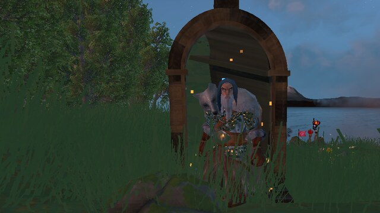

Replaced the screenshot on 10 October 2026 using the built-in imagegen tool. Exported as a 640 × 360 quality-90 JPEG with ImageMagick; source and published copies are identical.

Final prompt:

Use case: stylized-concept. Asset type: Local Portals mod-manager cover for Valheim, matching a cohesive collection of richly painted Nordic fantasy game covers. Create ONE beautiful wide landscape 16:9 illustration filling the whole frame, no text, title, logo, watermark, UI or border. Strong readable thumbnail composition. Two tall freestanding full-length wooden MIRROR PORTALS dominate a peaceful Viking courtyard: one large in the left foreground, the other on the right a short distance away. Both are upright human-sized arched mirror frames, rounded Roman arch tops, thick dark hand-carved oak mouldings with subtle Norse interlace, pale inner wooden beads, carved capitals at the arch spring, sturdy stepped wooden feet, small amber surtling gems on top. A slender luminous BLUE inlay outlines the left opening and a slender warm ORANGE inlay outlines the right opening. The glass interiors are clear perspective-correct windows into another nearby place, not reflective glass and not swirling energy. Through the left blue portal we see the warm amber-lit interior of a timber longhouse with hearth, beams and woven red cloth, while the orange portal stands beside that longhouse and shows a clear view of the cool green birch meadow outside. Make the opening look spatially deep, with a continuous floor and visible scene beyond, like stepping through a doorway with no loading screen. Main foreground blue frame and secondary orange frame both fully inside generous safe margins, uncluttered scene. Ground of mossy cobblestones, meadow grasses and a few white flowers, weathered longhouse with dragon-carved eaves in middle distance, pines and birches, soft Scandinavian mountains and blue fjord farther away. Warm late-afternoon sun, cool forest shadows, tiny restrained drifting motes near each mirror. Premium painterly game key art with tactile weathered timber, richly sculpted craftsmanship and gently faceted Valheim-inspired forms, natural amber walnut moss-green sky-blue palette. Clear bright portals distinguishable at 128x72, portal openings occupy much of the image. No people required. Avoid opaque magical swirls, neon glow, sci-fi machinery, stone Stargates, circular ring portals, ornate gilded Victorian mirrors, castles, glossy plastic, photo realism, clutter or extra portals.

## Wayfinder

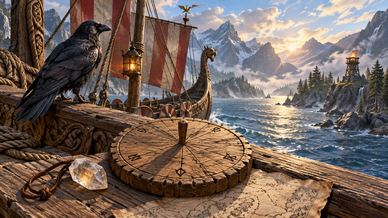

Generated on 11 October 2026 with the built-in imagegen tool. Exported using ImageMagick as a 640 × 360 quality-90 JPEG; source and published copies are identical.

Final prompt:

Use case: stylized-concept. Asset type: Wayfinder mod-manager cover for Valheim. Create ONE premium painted Nordic fantasy game illustration in wide landscape 16:9, matching tactile richly illustrated Viking mod covers. No lettering, words, title, logo, UI, border or watermark. Main foreground subject: a large handcrafted Viking SUN-COMPASS on the weathered oak rail of a longship, a circular honey-brown wooden disc with a deeply notched rim, carved directional strokes without letters, and a short upright central peg casting a sharp shadow across the disc. Beside it is a small clear translucent calcite SUNSTONE, rhomboid crystal with a simple leather loop, and part of an old parchment coastline chart with a subtle hand-drawn route, no text. A handsome black raven sits nearby on the ship's carved gunwale, facing the sea, unmistakable natural bird silhouette and matte feathers. The wooden dial and raven dominate, large and readable at 128x72; all focal objects inside generous safe margins. In the middle distance a red-and-cream square sail and carved dragon prow establish the Viking longship, with taut hemp ropes, a modest bronze gilded weather vane and warm mast lantern. Beyond the rail lies a sweeping blue Nordic fjord and rocky forested islands, a timber beacon tower with a tiny warm fire on a promontory guiding sailors toward land. Sun breaks through sea mist, warm golden highlights on timber and bronze against cool sea-blue and green-pine atmosphere. Style: polished painterly fantasy-game key art, detailed crafted materials, gently faceted Valheim-inspired forms, cinematic natural light, atmospheric depth, restrained organic colors. Clear focal hierarchy, one complete artwork filling frame. No modern navigation instruments, modern magnetic compass, glass telescope, sci-fi magic, glowing chart HUD, Vikings with horned helmets, neon, shiny plastic or photo realism.

## Jarldom

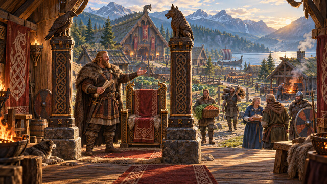

Generated on 11 October 2026 with the built-in imagegen tool. Exported using ImageMagick as a 640 × 360 quality-90 JPEG; source and published copies are identical.

Final prompt:

Use case: stylized-concept. Asset type: Jarldom mod-manager cover for Valheim, a living colony of reborn Viking souls. Create ONE premium richly painted Nordic fantasy game illustration, wide landscape 16:9, matching a cohesive collection of tactile Viking mod covers. No text, title, words, logo, UI, border or watermark. Scene: a thriving handcrafted Viking settlement at golden late afternoon, viewed from just inside its open great-hall porch. Main focal subject in the center foreground: a magnificent pair of HIGH-SEAT PILLARS, tall carved dark-oak square posts with Norse interlace down their shafts, dark forged-iron bands and squat stone plinths. One crowned by a carved wooden raven and the other a carved wooden wolf, their heads facing inward. A simple richly carved wooden jarl's high seat between them, its details picked out modestly in aged gold, a muted red woven wool cloth draped on it. Make the pillars and seat unmistakable, fully in frame with generous margins, and avoid any beam connecting the freestanding pillars. Beside the pillars stands a warm dignified Viking jarl in a fur mantle, brown wool and leather clothes, no horned helmet, holding a rolled parchment while welcoming his people. Beyond the porch, a clear view of the busy village courtyard: a farmer bringing a basket of harvested carrots, a woodcutter carrying split logs, a woman in a blue wool dress sharing bread with a villager, and a guard with a round wooden shield standing nearby. People are normal human Vikings, anatomically convincing and at coherent scale, a small distinct group rather than a crowd. Background: a beautiful dragon-gabled longhouse, a small smoky smithy, garden rows and timber stockpiles, homes beside a blue fjord beneath forested mountains. Cozy hearthlight inside porch, warm sun on settlement, cool mossy greens and blue distance. Tell a story of leadership, useful work, community and belonging among the reborn; grounded Norse craftsmanship. Style: polished painterly game key art, tactile hand-hewn timber, sculpted ornate carvings, gently faceted Valheim-inspired shapes, cinematic natural light, vivid natural colors, atmospheric depth. Strong focal hierarchy readable as a 640x360 thumbnail even at 128x72: main high-seat pillars large and visually dominant, workers secondary, distant village quiet. Artwork fills the entire frame. No modern town, medieval stone castle, fantasy crown, shiny plastic, sci-fi, neon magic, giant ethereal gods, horror, gore, armies or photorealism.

## GraveGoods

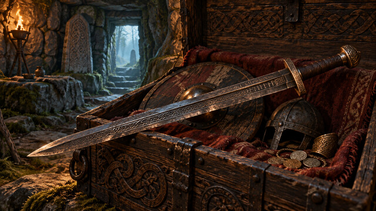

Replaced the screenshot on 11 October 2026 using the built-in imagegen tool. Exported with ImageMagick as a 640 × 360 quality-90 JPEG; source and published copies are identical.

Final prompt:

Use case: stylized-concept. Asset type: Grave Goods mod-manager cover for Valheim, matching a cohesive collection of richly painted Nordic fantasy game covers. Create ONE premium wide landscape 16:9 illustration, no text, title, logo, UI, border or watermark. Main subject: an extraordinary ancient Viking SAGA SWORD newly discovered in an open iron-bound wooden treasure chest in a mossy Norse burial chamber. The large sword lies diagonally across the chest's rim in the central foreground, its ENTIRE blade, modest straight crossguard, dark leather grip and rounded bronze pommel clearly visible inside generous safe margins. Authentic useful one-handed Viking sword proportions, a beautiful dark forged blade with a narrow fuller and intricate engraved interlace, a few delicate engraved runic marks catching a restrained warm amber light. Old and storied, carefully preserved, immensely precious rather than oversized fantasy weapon. The chest is hand-hewn dark oak, open lid, weathered iron straps, carved serpent knotwork, lined with faded red wool. Beside the sword in the chest sits a patinated round wooden shield with bronze boss, a simple iron helmet partly visible, and a small scattering of ancient coins. These secondary grave goods provide variety without clutter; sword and chest dominate and remain readable at 128x72. Background: intimate low stone barrow chamber with rough stacked stones, moss, roots creeping between blocks, a low burial slab and a softly visible carved standing stone. Cool blue-green daylight enters from a small doorway in the far background; warm amber torchlight picks out the blade, coins and weathered wood. A few subtle golden dust motes suggest the thrill of discovering a legendary heirloom, with no big magical particle storm. Premium painterly game key art, tactile richly crafted materials, gently faceted Valheim-inspired forms, sculpted details, cinematic natural light, atmospheric depth, muted earth and stone colors with focal amber and cool blue accents. One clear strong focal composition filling frame. Evoke rediscovered war-gear and forgotten Norse sagas. Avoid bones and bodies, gore, skeleton monsters, modern treasure vaults, giant gem piles, glowing neon weapons, oversized fantasy swords, mirror-polished chrome, shiny plastic, photo realism, crowds, modern objects, illegible decorative writing and inventory UI.

## Demolisher

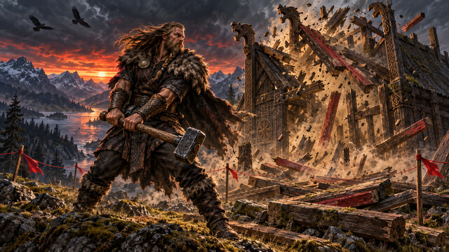

Generated on 12 October 2026 with the built-in imagegen tool. Heavy-metal-inspired Viking demolition artwork, exported with ImageMagick as a 640 × 360 quality-90 JPEG; source and published copies are identical.

Final prompt:

Use case: stylized-concept. Asset type: DEMOLISHER mod-manager cover for Valheim. Create ONE spectacular wide landscape 16:9 painted Nordic fantasy illustration with a LITTLE HEAVY-METAL ALBUM-COVER ATTITUDE, matching an established set of richly illustrated Valheim mod covers. NO lettering, title, words, logos, UI, border or watermark. Main focal subject: a formidable rugged Viking builder in a fur mantle, dark leather and weathered iron fittings, long windblown hair and braided beard, standing in an assertive grounded pose in the left-center foreground. He holds a clearly recognizable practical Viking BUILDER'S HAMMER with a hefty rectangular dark iron head and a carved wooden haft, diagonally across his body, two hands naturally gripping the one handle. Hammer prominently visible, sensible hand-tool proportions, no giant fantasy maul. A stern determined expression, no horned helmet. Behind and to his right a large ornate Viking timber longhouse is dramatically being DISMANTLED from the roof downward: dragon-carved gable beams splitting apart, roof boards falling into a cloud of ochre dust and flying small wooden splinters, some surviving wall posts still upright. A handful of neatly legible loose beams and boards land on the ground, evoking recovered building materials. No burning house, no explosives. Four simple wooden survey stakes carrying small CRIMSON RED cloth pennants bound the demolition area on the ground. A slender restrained dull-red line links the stakes in perspective, and a subtle crimson selection tint appears on a few falling timber pieces, integrating the mod's marking mechanic without looking like a HUD. Mood: fierce craftsmanship and controlled destruction, dramatic energy, storm-charcoal sky split by a narrow blood-red and burnt-orange sunset above a cold blue-grey Nordic fjord and dark pines. A couple of distant ravens wheel overhead. Strong angular composition, bold silhouettes, high contrast chiaroscuro, glowing dust backlit amber against slate shadows, carved knotwork and dragon eaves, earthy moss and iron. Premium painterly fantasy-game key art with tactile weathered wood, fur, rough stone and gently faceted Valheim-inspired forms. Viking and hammer dominate, demolition clearly readable behind, all main objects inside generous safe margins, legible as a 640x360 cover and at 128x72. Full-frame artwork. Heavy metal influence from dramatic lighting, windswept pose, crimson accents and raw power, while preserving authentic grounded Nordic materials. Avoid guitars, microphones, stage equipment, modern machines, chainsaws, firearms, sci-fi armour, rock-band logos, gratuitous spikes, skull piles, gore, victims, neon magic, polished plastic, photorealism or generic medieval stone castles.

## Delivery

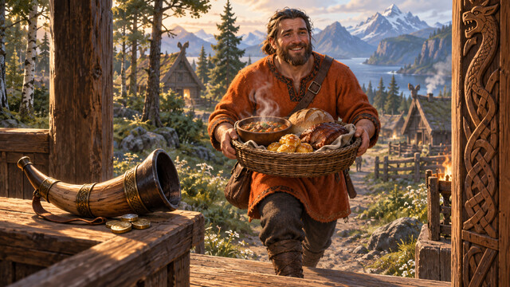

Replaced the screenshot on 12 October 2026 using the built-in imagegen tool. Exported with ImageMagick as a 640 × 360 quality-90 JPEG; source and published copies are identical.

Final prompt:

Use case: stylized-concept. Asset type: Delivery mod-manager thumbnail for Valheim. Create ONE beautiful wide landscape 16:9 illustration, matching a cohesive collection of richly painted Nordic fantasy game-mod covers. No lettering, title, words, logo, UI, border or watermark. Main focal subject: a friendly hardworking Viking FOOD COURIER arriving briskly toward the viewer along a woodland path, wearing a vivid naturally dyed burnt-orange wool tunic, brown leather belt, simple dark trousers and worn boots. Human Norse man with a short brown beard, tied-back dark hair, cheerful slightly winded expression, no helmet or armour. He carries a broad shallow woven wicker basket securely in both hands at waist height, with a few freshly cooked rustic meals clearly visible: a steaming wooden bowl of hearty stew nestled securely in the basket, a round loaf of bread, roasted meat wrapped in folded brown cloth and a couple of honey-glazed yellow pastries. Small gentle pale steam curls tell us this is hot food. An old brown leather satchel across his shoulder, no modern delivery box. The orange-clad courier and food are large, unmistakable and dominate the central frame, fully inside generous safe margins, natural coherent anatomy, normal useful proportions. Secondary foreground subject in the lower-left: an ERRAND HORN resting on a weathered timber porch rail, a curved hand-carved wooden signal horn with a widening dark bell, three simple patinated bronze bands and a small leather carrying strap. Beside it a few modest gold coins suggest payment. Courier approaching the porch of a cozy Viking longhouse: richly carved oak door-post at one edge, dragon-gabled timber homes glimpsed in the distance. Lush moss, a few white meadow flowers, birch and pine forest, a sliver of cool blue fjord and distant mountains beyond. Warm late-afternoon sunlight on his orange tunic, bread and carved horn, cool soft forest-green shadows. Mood: charming, useful, immersive and a little funny, a reliable hot-meal delivery in the Viking wilderness. Premium painterly fantasy-game key art, tactile handcrafted wood, wool, leather, wicker and food, gently faceted Valheim-inspired forms, cinematic natural light, rich organic palette, atmospheric background. Clear uncluttered composition readable at 640x360 and as small as 128x72, single complete artwork filling frame. Avoid modern takeaway packaging, pizza boxes, bicycles, motorcycles, delivery branding, aprons with writing, restaurant menus, modern uniforms, neon, shiny plastic, giant banquet piles, photo realism, extra hands, horns on helmets or magical food effects.

## Hallwright

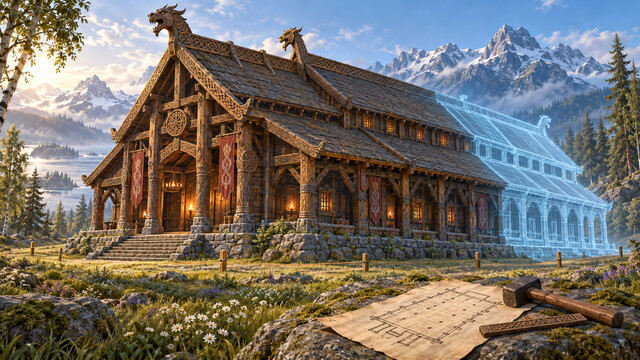

Generated on 14 October 2026 with the built-in imagegen tool for Hallwright's split from BuildShapes. Exported with ImageMagick as a 640 × 360 quality-90 JPEG; source and published copies are identical.

Final prompt:

Use case: stylized-concept. Asset type: Hallwright mod-manager cover for Valheim, the designer of whole Norse longhouses and stave halls from a staked-out floor plan. Create ONE premium richly painted Nordic fantasy game illustration, wide landscape 16:9, matching a cohesive set of tactile hand-crafted Viking mod covers. No title, text, lettering, logos, UI, border or watermark. Main focal subject: a magnificent complete VIKING KING'S LONGHOUSE, seen from a low front three-quarter angle in a flower-dotted Nordic meadow. Broad long rectangular footprint, proud high central gabled roof above lower side-aisle roofs, tiered layered timber eaves, ornate outward-facing DRAGON HEADS at the ridge ends, swept carved gable beams, dark oak colonnades and intricate Norse interlace braces, raised stone footing, welcoming covered entrance porch and wide front steps, muted red woven banners, warm amber hearthlight from open door and shuttered windows. Authentic grand wooden Norse architecture, no stone castle. The FRONT and LEFT two-thirds of the hall are fully built from tactile timber and stone; the RIGHT rear third smoothly transitions into a precisely aligned translucent pale CYAN BUILDING-PLAN GHOST showing the matching real roof pieces, beams, columns and wall panels before construction. Both halves form ONE continuous coherent same building, not separate buildings. Ghost lines reveal fitted structural framing and tiered roof geometry, restrained clear blue with visible contours, not neon glare and not an abstract hologram. Entire hall roof, ridge carvings, porch and ghost section safely inside frame, the hall dominates and is immediately readable as a magnificent complete building even at 128x72. Four or five small wooden layout stakes around its footprint mark the floor plan with thin amber lines close to ground, subtle secondary detail. Lower foreground: a corner of a parchment floor-plan drawing with a simple geometric outline, a small practical wooden carpenter's hammer and a carved measuring stick on a mossy flat stone, no writing or measurements. Background stays quiet: pines and birches, a misty blue fjord, rugged Scandinavian mountains, golden morning sun and cool atmospheric distance. Style: polished painterly game key art, richly sculpted craftsmanship, weathered wood, rough stone, gently faceted Valheim-inspired forms, warm natural amber and walnut against moss greens and soft sky blues. Strong focal hierarchy, inviting epic scale, believable joints and support, deep natural shadows, artwork fills the whole frame. Emphasize beautiful solved architecture and the pleasure of planning a great hall. Avoid freestanding giant arches as main subject, modern blueprint screens, interface panels, grids covering the entire image, text, fantasy palace spires, Victorian ornament, generic medieval castle, sci-fi, glossy plastic, photorealism, people blocking the building, magical vortexes or tiny clutter.
